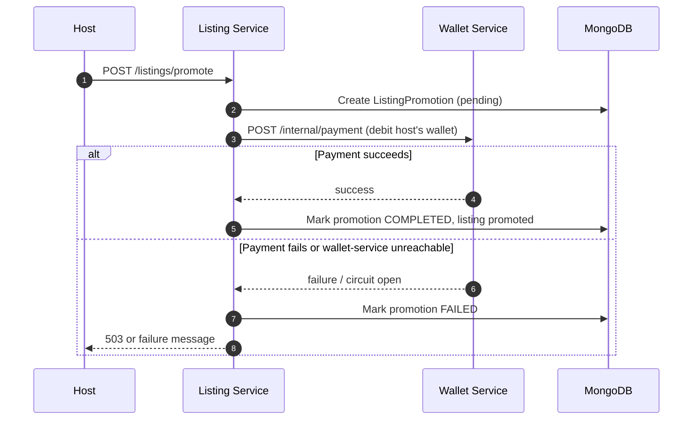

<p align="center">
  
</p>

<h1 align="center">Premisave Listing Service: Real Estate Listings, Bookings &amp; Ad Promotion API</h1>

<p align="center">
  <b>A production-minded Spring Boot 4 &amp; MongoDB microservice that powers listing management, short-term rental bookings, lead capture, and paid ad promotion for the Premisave real estate platform.</b>
</p>

<p align="center">
  <a href="https://github.com/peacemakerbill">
    
  </a>
  <br/>
  <sub>Built by <a href="https://github.com/peacemakerbill"><b>Bill Graham Peacemaker</b></a> (<code>@peacemakerbill</code>) · Backend Developer &amp; API Support Engineer · Nairobi, Kenya</sub>
</p>

<p align="center">
  
  
  
  
  
  
</p>

<p align="center">
  
  
  
  
  
</p>

<p align="center">
  <a href="https://github.com/peacemakerbill/premisave-listing-service/stargazers"></a>
  <a href="https://github.com/peacemakerbill/premisave-listing-service/network/members"></a>
  <a href="https://github.com/peacemakerbill/premisave-listing-service/issues"></a>
  <a href="https://github.com/peacemakerbill/premisave-listing-service/commits"></a>
  
  
  
</p>

<p align="center">
  <a href="#quick-start">Quick start</a> ·
  <a href="#architecture">Architecture</a> ·
  <a href="#how-ad-promotion-works">How ad promotion works</a> ·
  <a href="#how-bookings-work">How bookings work</a> ·
  <a href="#api-reference">API reference</a> ·
  <a href="#configuration-reference">Configuration</a> ·
  <a href="#troubleshooting">Troubleshooting</a>
</p>

> **If this saves you time building a Spring Boot listings/booking backend, please star the repo.** It helps other Kenyan fintech and proptech developers find it.

> **Disclaimer.** This is an independent, community-built project shared as a portfolio and reference implementation. It is not affiliated with or endorsed by any third-party service it integrates with. Always follow each provider's own current documentation for onboarding and go-live requirements.

---

## Table of contents

1. [What is this?](#what-is-this)
2. [Features](#features)
3. [Listing categories](#listing-categories)
4. [Architecture](#architecture)
5. [How ad promotion works](#how-ad-promotion-works)
6. [How bookings work](#how-bookings-work)
7. [Lead capture (listing interest)](#lead-capture-listing-interest)
8. [Currency model](#currency-model)
9. [Listing images](#listing-images)
10. [Quick start](#quick-start)
11. [Build and run](#build-and-run)
12. [Configuration reference](#configuration-reference)
13. [API reference](#api-reference)
14. [Testing with Postman or curl](#testing-with-postman-or-curl)
15. [Rate limiting](#rate-limiting)
16. [Data model](#data-model)
17. [Going live](#going-live)
18. [Security notes](#security-notes)
19. [Project structure](#project-structure)
20. [Troubleshooting](#troubleshooting)
21. [Upgrading from earlier deliveries](#upgrading-from-earlier-deliveries)
22. [Known limits](#known-limits)
23. [Roadmap ideas](#roadmap-ideas)
24. [Contributing](#contributing)
25. [Author](#author)

---

## What is this?

**Premisave Listing Service** is the real estate catalog and transaction backbone of the Premisave platform: a Java Spring Boot microservice that lets home owners list short-term rentals, long-term rentals, leases, land, and houses for sale, and lets customers browse, book, and express interest in them.

It does not move money on its own — it delegates every wallet debit, credit, and transfer to the sibling `wallet-service`, and every identity/profile lookup to the sibling `auth-service` — but it owns the domain logic that decides *when* money should move: a promotion payment when a host boosts a listing, a tenant-to-owner payment when a short-term booking is confirmed, and an owner-to-tenant refund when that booking is cancelled.

It:

- exposes one listings API across five property categories, each with its own fields, behind a shared base contract for search, filtering, and pagination,
- lets a host pay to promote a listing (a wallet-service debit) for a configurable daily rate, with a scheduled sweep that expires promotions automatically,
- lets a customer book a short-term rental — by day, by night, or a listing can offer both — with the payment going straight to the owner (or, optionally, held by wallet-service in escrow until after check-in), an atomic guard against double booking, and refunds that follow the listing's cancellation policy,
- lets a customer express interest in a long-term rental, lease, or sale without any money changing hands, giving the owner a lead to follow up on,
- sends HTML email notifications for every one of those state changes, to both parties, and
- never stores a person's mutable profile data (name, phone, address, photo) — only their stable user ID and email are kept; everything else is fetched live from `auth-service` on every response, so it can never go stale.

It was built for the Premisave platform's own microservice ecosystem (alongside `auth-service` and `wallet-service`), and recently upgraded to Spring Boot 4.1.1 / Spring Framework 7.

## Features

| | |
|---|---|
| **Five listing categories, one API** | Short-term rentals, long-term rentals, leases, land sales, and house sales — each with category-specific fields, searchable and filterable through a shared endpoint. |
| **Short-term rental bookings** | Day and/or night pricing per listing, a per-night claim that makes double booking impossible, optional escrow (off by default; wallet-service holds the payment and the owner is paid after check-in), FLEXIBLE / MODERATE / STRICT cancellation policies, `Idempotency-Key` support, and a scheduled job that marks past-checkout bookings complete. |
| **Ad promotion** | Pay a configurable daily rate to feature a listing; extend an active promotion; a scheduled sweep automatically deactivates expired ones. |
| **Lead capture (listing interest)** | No-money "contact me" flow for long-term rentals, leases, and sales — the owner gets the lead's contact details, fetched live rather than stored. |
| **Live currency display** | Scheduled background refresh from the Frankfurter API, USD-based, for browsing listings in other currencies. |
| **HTML email notifications** | Booking confirmed/cancelled, interest expressed/cancelled — sent to both parties, Thymeleaf-rendered, styled to match the platform's wallet-service emails. |
| **Tiered, distributed rate limiting** | Redis-backed via Bucket4j, per authenticated user or IP, with separate budgets for ordinary browsing, listing writes, and money-moving/lead-generating actions. |
| **Circuit-breaker-protected integrations** | Every call to `auth-service` and `wallet-service` goes through a Feign client with a Resilience4j circuit breaker and an explicit fallback, so a dependency outage fails cleanly instead of hanging. |
| **Admin listing management** | Role-gated (`ADMIN`/`FINANCE`) endpoints for moderating listings across the whole platform. |
| **Folder-based image storage** | Listing photos are kept in a local folder or a mounted network share (same `STORAGE_*` settings as wallet-service). Uploads are checked by content, re-encoded (GPS and other metadata removed), and saved as thumbnail, medium and original sizes. Owners can add, delete, reorder and pick a cover image. |
| **Stuck-payment reconciliation and email outbox** | A booking whose payment result was lost is retried safely and never left half-done; notification emails are queued in the database and retried until sent. |
| **Availability calendar** | Public per-listing view of taken and blocked nights; owners can block dates for maintenance or personal use. |
| **OpenAPI 3 documentation** | Full API spec generation via springdoc-openapi (disabled by default in production). |

## Listing categories

| Category | Distinguishing fields |
|---|---|
| **Short-term rental** | `pricePerDay` and/or `pricePerNight`, max guests, bedrooms, bathrooms, amenities, Wi-Fi/kitchen flags. |
| **Long-term rental** | Minimum lease months, furnished flag, tenant requirements. |
| **Lease** | Lease duration, deposit amount, lease terms, renewable flag. |
| **Land sale** | Size in acres, land use type, title deed status. |
| **House sale** | Floors, plot size, garage, property type. |

Every category also carries a `priceUnit` (`PER_NIGHT`, `PER_DAY`, `PER_MONTH`, or `TOTAL`) so a listing's price is never ambiguous about what it actually means — resolved automatically per category if the host doesn't specify one.

## Architecture

```
┌──────────────┐      JWT       ┌────────────────────────┐
│   End User   │ ─────────────► │                        │
└──────────────┘                │                        │      ┌─────────────┐
                                 │  Premisave Listing     │ ───► │ auth-service│
┌──────────────┐  JWT forward   │      Service            │      │ (identity,  │
│ auth-service │ ◄────────────► │  (this repository)     │      │  profiles)  │
├──────────────┤                │                        │      └─────────────┘
│wallet-service│ ◄── X-API-Key ►│  MongoDB <-> Redis     │      ┌─────────────┐
└──────────────┘                │                        │ ───► │wallet-service│
                                 │                        │      │ (money      │
                                 └────────────────────────┘      │  movement)  │
                                          │        │              └─────────────┘
                                          ▼        ▼
                                  Image folder  Frankfurter API
                                 (local/share)  (currency rates)
```

**Design choices**

- **This service decides *when* money should move; wallet-service is the only thing that actually moves it.** Promotions call wallet-service's `/internal/payment` (debit for a service charge); bookings call `/internal/transfer` (direct wallet-to-wallet). Neither ever touches a payment gateway directly.
- **Two different trust models for two different Feign clients.** Calls to `auth-service` forward the caller's own JWT — identity checks there are always "is this really who they claim to be." Calls to `wallet-service` use a static, shared internal API key — that trust boundary authenticates the *calling service*, not the end user.
- **No cached personal data.** `Booking` and `ListingInterest` store only a user's ID and email — full name, phone, address, and profile picture are fetched fresh from `auth-service` every time a response is built. If `auth-service` is unreachable when that fetch happens, the request fails with a clear error rather than returning stale or incomplete data.
- **Escrow is optional and off by default.** With `ESCROW_ENABLED=true`, a tenant's payment is held by wallet-service in an escrow record (`POST /internal/escrow/hold`) and paid to the owner `escrow.release-delay-hours` after check-in. A cancellation marks the booking `CANCELLED` first, atomically, then pays the refund (and any share the owner keeps) out of that hold. A payout that fails is retried with a fixed reference, and parked as `NEEDS_REVIEW` after `escrow.max-attempts`, so nothing is silently lost.
- **Double booking is blocked by the database, not by a check.** Each night of a stay is a document with a unique id (`listingId|date`); a booking claims its nights before any money moves, and a second claim on the same night fails.
- **Retries are safe.** Booking and promotion requests accept an `Idempotency-Key` header; repeating a request with the same key returns the original result instead of charging again. Scheduled jobs take a lock in MongoDB so only one instance runs each at a time.

## How ad promotion works



A scheduled job (`AdPromotionService.deactivateExpiredPromotions`, every 5 minutes by default) sweeps `COMPLETED` promotions whose end date has passed and deactivates them — a listing is never left showing as promoted after it should have expired.

## How bookings work

**By default (escrow off)** the tenant pays the owner directly in one wallet-service transfer at booking time. Wallet-service adds its commission on top, so on a 100.00 booking at 1% the tenant is debited 101.00, the owner receives exactly 100.00, and the company ledger earns 1.00, once. A cancellation refunds the owner's wallet back to the tenant (see [Cancellation policies](#cancellation-policies)).

**With escrow on** (`ESCROW_ENABLED=true`) the flow below applies. Wallet-service holds the money in an escrow record that belongs to no wallet and charges its commission once, when the tenant pays. Payouts out of the hold carry no commission, so the company still earns exactly the configured rate, the owner receives exactly the price, and a cancellation costs the tenant only the fee.

```mermaid
sequenceDiagram
    autonumber
    participant T as Tenant
    participant LS as Listing Service
    participant WS as Wallet Service
    participant O as Owner (via email)

    T->>LS: POST /bookings (listing, dates, priceUnit, Idempotency-Key)
    LS->>LS: Claim one slot per night (unique, atomic)
    LS->>WS: POST /internal/escrow/hold (price; fee added by wallet-service)
    alt Hold succeeds
        WS-->>LS: HELD, commission, totalDebited
        LS->>LS: Mark booking CONFIRMED, escrow HELD
        LS-->>T: Email: booking confirmed
        LS-->>O: Email: new booking received
    else Hold fails
        LS->>LS: Mark booking FAILED, free the nights
    end

    Note over T,O: Check-in plus release delay

    LS->>WS: POST /internal/escrow/booking-ID/payouts (owner, full price)
    LS->>LS: Escrow RELEASED

    Note over T,O: Or, before that, a cancellation

    T->>LS: POST /bookings/{id}/cancel
    LS->>LS: Mark CANCELLED, work out the refund from the policy, free the nights
    LS->>WS: POST /internal/escrow/booking-ID/payouts (tenant, refund)
    LS->>WS: POST /internal/escrow/booking-ID/payouts (owner, share kept)
    LS-->>T: Email: cancellation and refund
    LS-->>O: Email: booking cancelled
```

### Wallet-service fees

Wallet-service charges a commission (`internalTransferRate`, 1% at the time of writing) on top of every transfer: the sender is debited the amount plus the fee, the recipient receives exactly the amount. The rate is read from `GET /internal/commission/rates` and cached for five minutes (`wallet.commission.cache-seconds`); it is never hard coded.

By default there is one transfer per booking, so the fee is charged once and paid by the tenant. With escrow on there is one hold per booking: wallet-service debits the tenant the price plus the fee, once, and keeps the price in the escrow record. For a price of 100.00 at 1% the tenant is debited 101.00, the company ledger earns 1.00, and the owner is later paid exactly 100.00. `fundingAmount` on the booking is what the tenant was debited (101.00) and `commissionAmount` is the fee (1.00), both taken from wallet-service's answer.

Two consequences to know about (escrow on):
- A cancellation refund returns the **booking price**, not the fee the tenant paid. The fee is wallet-service's income and is never refunded, so "100% refund" means 100% of the price and the tenant is out the fee. The cancellation message and the cancellation quote say so.
- Payouts add up to exactly the price held (the refund plus the owner's share, with no fee on either), so no float or spare balance is needed anywhere.

### Wallet-service escrow endpoints

Escrow uses three wallet-service endpoints (see wallet-service's `ESCROW_API_README.md`): `POST /internal/escrow/hold`, `POST /internal/escrow/{holdReference}/payouts` and `GET /internal/escrow/{holdReference}`. They need the same `X-API-Key` as the other internal calls, and wallet-service accepts them only for `initiatedBy` values on its `ESCROW_ALLOWED_INITIATORS` list (default `LISTING_SERVICE`, which is what this service sends).

References are idempotency keys, fixed per booking: `booking-ID` for the hold, `booking-release-ID` for the owner's payout after check-in, `booking-refund-ID` for the tenant's refund and `booking-payout-ID` for the owner's share of a split cancellation. A repeated reference gets 409 and moves nothing; every 409, timeout or outage is checked with the `GET` call before anything is decided, and a record that wallet-service still shows as `PENDING` is treated as "not known yet". A hold or payout that ended `FAILED` (nothing moved) can be sent again with the same reference, so a declined payment can be retried.

### When a payment result is lost

Wallet-service rejects a repeated `reference` with **409** instead of repeating its first answer, and writes a transfer record only after the money has moved. So before anything is retried, the record is checked with `GET /internal/transfer/{reference}`:

| What happened | What the service does |
|---|---|
| Transfer succeeds | Booking `CONFIRMED`. |
| 409, timeout, outage or 5xx | Looks the reference up. A record means it was paid. No record means unknown. |
| 422, 403, 404 or 400 | A real refusal, nothing moved: booking `FAILED`, nights freed. |
| Unknown | Booking stays `PENDING` with its nights held; the tenant gets a "could not confirm yet" error. |

After `booking.reconciliation.pending-after-minutes` the reconciliation job looks the payment up again. A record confirms the booking; with none, it sends the transfer again with the same reference (a 409 is checked against the record once more), a refusal fails the booking, and repeated errors end in `NEEDS_REVIEW` after `max-attempts`. The wait matters: wallet-service has no unique index on the reference, so the same reference must never be sent twice at the same moment. Payouts and refunds follow the same rule, so a payout that already went through is marked released, not failed.

An admin settles a `NEEDS_REVIEW` booking with `POST /admin/bookings/{id}/resolve-payment?paid=true|false` after checking the wallet history. Payouts that kept failing show up under `GET /admin/bookings/needs-review` and can be retried with `POST /admin/bookings/{id}/retry-payout`.

### Availability and blocked dates

`GET /listings/{listingId}/availability?from=&to=` is public and returns the taken and blocked nights in that range. Owners use `POST /listings/{listingId}/blocked-dates` (a date range) and `DELETE /listings/{listingId}/blocked-dates/{blockId}` to take nights off the market; blocks use the same one-document-per-night claim as bookings, so a block and a booking can never overlap.

### Cancellation policies

Each short-term listing can set `cancellationPolicy` (`FLEXIBLE`, `MODERATE` or `STRICT`); listings without one use `booking.cancellation.default-policy`. The tiers are in `application.yml`:

| Policy | Full refund | Half refund | Otherwise |
|---|---|---|---|
| `FLEXIBLE` | 24 hours or more before check-in | Less than 24 hours before | 0% once the stay has started |
| `MODERATE` | 5 days or more before | 24 hours to 5 days before | 0% |
| `STRICT` | 14 days or more before | 7 to 14 days before | 0% |

If the **owner** cancels, the tenant is always refunded in full. `GET /bookings/{id}/cancellation-quote` shows what a cancellation would refund right now, without changing anything. Bookings paid straight to the owner (escrow off, or made before escrow existed) are refunded in full from the owner's wallet, as before. With escrow on, the percentages apply to the price and the wallet fee paid at booking is not refunded.

### Background jobs

| Job | Default schedule | What it does |
|---|---|---|
| Booking completion | every 5 min | Marks `CONFIRMED` bookings `COMPLETED` once check-out has passed. |
| Escrow release (escrow on only) | every 5 min | Pays the owner for held bookings once `release-delay-hours` have passed since check-in. |
| Settlement retry | every 3 min | Retries cancellation payouts that did not go through. |
| Pending-booking reconciliation | every 2 min | Retries the payment of bookings left `PENDING` after a lost wallet-service answer (same reference, so it cannot charge twice). |
| Email outbox | every 30 s | Sends queued notification emails, retrying with a delay; marks one `DEAD` after the last attempt. |
| Promotion expiry | every 5 min | Deactivates expired promotions. |
| Currency refresh | hourly | Refreshes exchange rates in Redis. |

Each job takes a lock in the `scheduler_locks` collection, so running several instances is safe.

## Lead capture (listing interest)

For categories where an instant, priced booking doesn't make sense — long-term rentals, leases, land, and house sales — a customer can express interest instead. No money moves. `ListingInterestService` records only the customer's stable ID and email, then fetches their full contact details live from `auth-service` whenever a response is built for the *owner's* side, and the owner's details for the *customer's* side — each party only ever sees the other party's information, never an echo of their own. Cancelling interest deletes the record entirely; there's no retained history of past leads once withdrawn.

## Currency model

- **USD is the base currency** for both listing prices and everything wallet-service settles in.
- **`CurrencyService`** fetches live rates from the [Frankfurter API](https://www.frankfurter.dev/), refreshed on a schedule and cached in Redis, so converting a listing's price for display never costs a live API call on the request path.
- Currency conversion here is **display-only** — actual payment settlement (promotions, bookings) always happens in USD through wallet-service, which has its own settlement currency model.

## Listing images

Photos live in a folder, chosen by the same settings wallet-service uses:

| Mode | Use it when |
|---|---|
| `LOCAL` | One instance, development. Files go under `STORAGE_ROOT`. |
| `NETWORK` | Several instances, or the files should live on a file server. Mount the share on the machine first (SMB, NFS, ...) and point `STORAGE_NETWORK_MOUNT_PATH` at it. |

In `NETWORK` mode the service reads `/proc/self/mountinfo` to confirm the path is a real mount. A plain folder check is not enough: an unmounted share leaves an empty local folder that quietly fills the disk. With `STORAGE_NETWORK_REQUIRE_MOUNT=true` the app refuses to start without the mount, and if the share drops later, uploads and image requests answer **503** like an auth-service or wallet-service outage. Mount detection only works on Linux, so test it on the real server.

What happens to an upload:

- The file is accepted only if its first bytes say JPEG or PNG; the file name and declared type are ignored. Limits: 10 MB per file, 20 images per listing, 40 million pixels (all in `application.yml`). WebP is not supported.
- The picture is rotated upright from its camera orientation, flattened onto white, and re-encoded as JPEG, which drops all metadata including GPS position.
- Three sizes are written: `thumb` (320 px wide), `medium` (960) and `original` (up to 2560), named with a random 32-character id, never the client's file name, under `<folder>/<first two characters>/`. Each file is written to a temporary name and moved into place in one step, and anything partly written is removed on failure.
- The listing stores the URL `STORAGE_PUBLIC_BASE_URL/images/<id>`. Add `?size=thumb` for list views. Responses are cacheable for a year (the content of an id never changes) and support `ETag`.
- Each image is recorded with the user who uploaded it, so an owner can only attach or delete their own pictures.

Owner endpoints: `POST /listings/{id}/images` (add), `DELETE /listings/{id}/images/{fileId}`, `PUT /listings/{id}/images/cover` (`{"fileId": "..."}`), `PUT /listings/{id}/images/order` (`{"fileIds": [...]}`). Creating or updating a listing with `files` still works, and an update now **adds** to the existing images instead of replacing them. Hard-deleting a listing as an admin removes its files; an owner's soft delete keeps them.

Old Cloudinary URLs on existing listings are absolute, so they keep working and are never touched. In production serve `/images` through nginx or a CDN rather than the Spring app, back up the folder, and give the app's account write access to it.

## Quick start

### Prerequisites

- **Java 21**
- **Maven 3.9+**
- **MongoDB** running locally, in Docker, or on Atlas
- **Redis** running locally or hosted (rate limiting and currency-rate caching)
- Running instances of `auth-service` and `wallet-service` (or their sandbox equivalents) for full functionality
- SMTP credentials (any provider) for email notifications
- A writable folder for listing images (local, or a network share mounted on the server)

```bash
# 1. Clone
git clone https://github.com/peacemakerbill/premisave-listing-service.git
cd premisave-listing-service

# 2. Start MongoDB and Redis (skip if you already have them)
docker run -d --name listing-mongo -p 27017:27017 mongo:8
docker run -d --name listing-redis -p 6379:6379 redis:7

# 3. Create your .env (see the next section), then run
mvn spring-boot:run
```

Create a `.env` file next to `pom.xml`:

```properties
# Core
MONGODB_URI=mongodb://localhost:27017/premisave-listing
REDIS_HOST=localhost
REDIS_PORT=6379
JWT_SECRET=<a long, random secret shared with auth-service>
INTERNAL_SERVICE_API_KEY=<a shared secret, identical across every Premisave microservice>

# Sibling services
AUTH_SERVICE_URL=http://localhost:8080
WALLET_SERVICE_URL=http://localhost:8084

# Email
MAIL_HOST=smtp.gmail.com
MAIL_PORT=587
MAIL_USERNAME=...
MAIL_PASSWORD=...

# Only if you turn escrow on (wallet-service must have the escrow endpoints deployed)
# ESCROW_ENABLED=true
```

> **Important:** `INTERNAL_SERVICE_API_KEY`, `JWT_SECRET`, and the mail credentials all have **no default value** — the app fails to start rather than silently run with a placeholder. This is deliberate: a wrong-but-present placeholder here has previously caused confusing 401s and misdirected emails at *request* time instead of a clear failure at startup.

When the service is healthy you will see lines like:

```
Tomcat started on port 8082 (http) with context path '/'
Exchange rates refreshed: 166 currencies cached from Frankfurter (base=USD).
```

## Build and run

```bash
# Compile and package an executable jar
mvn clean package

# Run it (environment variables or a .env in the working directory)
java -jar target/premisave-listing-service-0.0.1-SNAPSHOT.jar
```

**Notes**

- `.env` is loaded from the working directory. Real environment variables (Docker, Kubernetes, systemd) also work and take precedence over `.env`.
- The service starts on **port 8082** by default (`server.port` in `application.yml`).
- Recently upgraded to **Spring Boot 4.1.1** — if building from source, note that `spring-boot-starter-web` is now `spring-boot-starter-webmvc`, and a `spring-boot-jackson2` compatibility module is required alongside `spring.http.converters.preferred-json-mapper: jackson2`, since several parts of this codebase (security config, the rate limiter, Feign's own converters) still expect a Jackson 2 `ObjectMapper` bean rather than Boot 4's default Jackson 3 `JsonMapper`.

## Configuration reference

`application.yml` has no defaults for environment variables: every variable below must be set in `.env` (or the real environment), and the service stops at startup if one is missing. `.env.example` lists all of them with sensible local values; only the secrets are blank. The exception is `APP_TIME_ZONE`, which is optional.

| Environment variable | Example value | Description |
|---|---|---|
| `JWT_SECRET` | none, secret | Must match every other Premisave service validating the same tokens. |
| `INTERNAL_SERVICE_API_KEY` | none, secret | Shared secret every Premisave microservice presents as `X-API-Key` for service-to-service calls, the same value across the whole platform. |
| `MAIL_HOST` / `MAIL_PORT` / `MAIL_USERNAME` / `MAIL_PASSWORD` | none, secret | SMTP credentials for booking/interest notification emails. |
| `MAIL_FROM` | `no-reply@premisave.com` | The "From" address on every notification email. |
| `MONGODB_URI` | `mongodb://localhost:27017/premisave-listing` | MongoDB connection string. |
| `REDIS_HOST` / `REDIS_PORT` | `localhost` / `6379` | Redis connection for rate limiting and currency-rate caching. |
| `AUTH_SERVICE_URL` | `http://localhost:8080` | Base URL of auth-service. |
| `WALLET_SERVICE_URL` | `http://localhost:8084` | Base URL of wallet-service. |
| `FRANKFURTER_BASE_URL` | `https://api.frankfurter.dev` | Currency-rate API base URL. |
| `FRONTEND_URL` | `http://localhost:3000` | Frontend address. |
| `CORS_ALLOWED_ORIGINS` | `http://localhost:3000` | Comma-separated list of allowed origins. |
| `STORAGE_MODE` | `LOCAL` | `LOCAL` or `NETWORK`. See [Listing images](#listing-images). |
| `STORAGE_ROOT` | `/home/graham218/MyProjects/file-storage/premisave-listing` | Image folder when the mode is `LOCAL`. |
| `STORAGE_PUBLIC_BASE_URL` | `http://localhost:8082` | Origin that serves `GET /images/{id}`; saved inside the image URLs on listings. Set it to the public address (or CDN) in production. |
| `STORAGE_NETWORK_PROTOCOL` / `_HOST` / `_SHARE` | `SMB` / blank / blank | Describe the share (used in messages only; the operating system does the mounting). Used only in `NETWORK` mode; keep the lines, leave them blank if unused. |
| `STORAGE_NETWORK_MOUNT_PATH` | blank | Where the share is mounted on this machine. Must be filled in `NETWORK` mode. |
| `STORAGE_NETWORK_DIRECTORY` | `premisave-listing` | Folder for this service inside the mount. |
| `STORAGE_NETWORK_REQUIRE_MOUNT` | `true` | Refuse to start (and answer 503) if the mount path is not an actual mount. |
| `ESCROW_ENABLED` | `false` | `true` has wallet-service hold payments in escrow until after check-in. Needs the wallet-service escrow endpoints. Do not switch it off while bookings are still held. |
| `ESCROW_RELEASE_DELAY_HOURS` | `24` | Hours after check-in before the owner is paid from the escrow hold. `0` pays at check-in time. |
| `APP_TIME_ZONE` | unset (server zone) | Optional. JVM time zone, for example `Africa/Nairobi`. Check-in dates, the completion sweep and cron jobs follow it. |

Rate-limit tiers, promotion pricing, and the scheduled-job cron expressions are all tunable directly in `application.yml` (`rate-limit.*`, `ad.promotion.*`, `booking.*` including the cancellation tiers and reconciliation, `escrow.*`, `email.outbox.*`, `storage.*`) — see the file itself for the full set, each documented inline.

The service **refuses to start** if `JWT_SECRET`, `INTERNAL_SERVICE_API_KEY` or the mail credentials are missing, by design. (The old holding-account settings no longer exist.)

## API reference

Base URL (local): `http://localhost:8082`

| Namespace | Auth | Purpose |
|---|---|---|
| `/listings/**` | Mixed — browsing is public, writes require a JWT with `HOME_OWNER` role | Listing CRUD, search, promotion |
| `/bookings/**` | JWT | Short-term rental booking and cancellation |
| `/interests/**` | JWT | Lead capture: express/cancel interest |
| `/currency/**` | Public | Display-only currency conversion |
| `/admin/**` | JWT (`ADMIN`/`FINANCE` roles) | Cross-platform listing moderation, and booking review (`/admin/bookings/needs-review`, `/retry-payout`, `/resolve-payment`) |
| `/images/{fileId}` | Public | Serves a stored listing image: `?size=thumb\|medium\|original` |
| `/social/**` | JWT | Pass-through proxy to auth-service's social features |

### `POST /listings/promote`: promote a listing

| | |
|---|---|
| **Header** | `Authorization: Bearer <JWT>` |
| **Optional header** | `Idempotency-Key: <unique string>`. A repeat with the same key returns the first result without charging again. The same header works on `POST /listings/{id}/extend`. |

```json
{
  "listingId": "6a8f4a873fdf5d2d54072cb2",
  "days": 7
}
```

### `POST /bookings`: book a short-term rental

| | |
|---|---|
| **Header** | `Authorization: Bearer <JWT>` |
| **Optional header** | `Idempotency-Key: <unique string, up to 100 characters>`. Repeating a request with the same key returns the first booking instead of creating or charging again. |

```json
{
  "listingId": "6a8f4a873fdf5d2d54072cb2",
  "checkIn": "2026-10-10T14:00:00",
  "checkOut": "2026-10-13T11:00:00",
  "priceUnit": "PER_NIGHT"
}
```

Response includes both parties' details, fetched live:

```json
{
  "id": "6a9f1b2c3d4e5f6789012345",
  "status": "CONFIRMED",
  "totalAmount": 165.00,
  "currency": "USD",
  "cancellationPolicy": "MODERATE",
  "escrowStatus": "HELD",
  "fundingAmount": 166.65,
  "success": true,
  "tenant": { "fullName": "...", "email": "...", "phoneNumber": "...", "...": "..." },
  "owner": { "fullName": "...", "email": "...", "phoneNumber": "...", "...": "..." }
}
```

### `POST /interests`: express interest in a listing

| | |
|---|---|
| **Header** | `Authorization: Bearer <JWT>` |

```json
{
  "listingId": "6a8f4eb1ed197f0d0f537650",
  "message": "Looking to move in next month, is it still available?"
}
```

### `GET /listings/search`: public listing search

| | |
|---|---|
| **Auth** | None |
| **Query** | `query`, `category`, `minPrice`, `maxPrice`, `city` — all optional |

## Testing with Postman or curl

```bash
BASE=http://localhost:8082
TOKEN="<a real JWT for a test user>"

# Search listings (public, no auth)
curl -s "$BASE/listings/search?category=SHORT_TERM_RENTAL&city=Nairobi"

# Book a short-term rental
curl -s -X POST "$BASE/bookings" \
  -H "Authorization: Bearer $TOKEN" \
  -H "Content-Type: application/json" \
  -d '{"listingId":"<listing id>","checkIn":"2026-10-10T14:00:00","checkOut":"2026-10-13T11:00:00","priceUnit":"PER_NIGHT"}'

# Express interest in a listing
curl -s -X POST "$BASE/interests" \
  -H "Authorization: Bearer $TOKEN" \
  -H "Content-Type: application/json" \
  -d '{"listingId":"<listing id>","message":"Is this still available?"}'
```

**Collection variables worth saving in Postman:** `base_url_listing`, `token`, `listing_id`, `booking_id`, `interest_id`.

## Rate limiting

Redis-backed, per authenticated user (falling back to IP for anonymous requests), split into three independent tiers so exhausting one doesn't affect the others:

| Tier | Default budget | Applies to |
|---|---|---|
| `default` | 300/min | Ordinary browsing — search, view a listing, currency rates |
| `write` | 30/min | Creating, editing, deleting listings |
| `sensitive` | 10/min | Bookings, cancellations, promotions, expressing interest — deliberately strict, since these are exactly what fraud/spam patterns target |

Every number, and the exact path patterns assigned to each tier, is configurable in `application.yml` under `rate-limit.*` — no code change needed to retune.

## Data model

| Entity | Purpose |
|---|---|
| `Listing` (base) and its subtypes `ShortTermRental`, `LongTermRental`, `Lease`, `LandSale`, `HouseSale` | One collection per category, sharing a common base (title, price, owner, status, images). |
| `Booking` | A short-term rental booking: dates, `priceUnit`, `totalAmount`, `status` (`PENDING`/`CONFIRMED`/`COMPLETED`/`CANCELLED`/`FAILED`), payment/refund references, cancellation policy, escrow state (`HELD`, `RELEASED`, `SETTLING`, `SETTLED`, `NEEDS_REVIEW`) and refund amounts. Stores only `tenantId`/`tenantEmail` and `ownerId`/`ownerEmail` — nothing else about either party. |
| `BookingSlot` | One document per listing per night (`listingId|date`), the unique claim that prevents double booking. Removed on failure or cancellation; expires a week after check-out. |
| `EmailOutbox` | A queued notification email: template, variables, status (`PENDING`/`SENT`/`DEAD`), attempts. Sent ones are deleted after `keep-sent-days`. |
| `ImageAsset` | Who uploaded a stored image, keyed by its file id. |
| `SchedulerLock` | One document per scheduled job, so only one instance runs it at a time. |
| `ListingInterest` | A lead: `customerId`/`customerEmail`, the listing, and an optional message. Deleted entirely on cancellation. |
| `ListingPromotion` | A paid promotion period on a listing: daily rate, currency, end date, payment status. |
| `Payment` | Local audit record of every wallet-service debit this service initiates. |

## Going live

1. **Confirm `auth-service` and `wallet-service` are both reachable** at the URLs configured — this service degrades to clear 503s rather than silent failures when either is down, but neither promotions nor bookings can complete without them.
2. **Set strong secrets** for `JWT_SECRET` and `INTERNAL_SERVICE_API_KEY`, identical across every Premisave service that needs them, kept outside git.
3. **`recipientAccountNumber` is the recipient's email** (confirmed by wallet-service). Every recipient, owners and tenants, must already have a wallet, or the transfer or escrow hold fails with 404.
4. **Disable Swagger/OpenAPI** (`springdoc.api-docs.enabled` / `springdoc.swagger-ui.enabled: false`) if not already off — both endpoints are public by default.
5. **If you turn escrow on**, deploy wallet-service with the escrow endpoints first and set `ESCROW_ENABLED=true`. There is no holding wallet to create or top up. Watch the logs (or query bookings with `escrowStatus: NEEDS_REVIEW`) for payouts that kept failing.
6. **Redeploy wallet-service with `GET /internal/transfer/{reference}` and `GET /internal/commission/rates`.** Booking payments, reconciliation and payouts call both; without them, bookings cannot be created. Escrow additionally needs the three `/internal/escrow` endpoints.

## Security notes

- **JWT authentication** for authenticated endpoints, validated against the platform's shared secret; public browsing endpoints (search, view a listing) require no token at all.
- **Internal API key authentication** (`X-API-Key`) for calls to wallet-service, kept entirely separate from the JWT forwarded to auth-service — the two trust boundaries never mix.
- **Role-based access control** on write operations (`HOME_OWNER`) and admin endpoints (`ADMIN`/`FINANCE`).
- **No cached personal data** — `Booking` and `ListingInterest` never store a name, phone number, address, or profile picture; both are fetched live from auth-service on every read, and the request fails cleanly if auth-service is unreachable rather than returning stale data.
- **Tiered rate limiting** via a Redis-backed token-bucket algorithm, with the strictest budget on money-moving and lead-generating actions specifically.
- **Refunds never precede the actual money movement** — a booking only becomes `CANCELLED` after its wallet-service refund transfer succeeds.
- **Stateless sessions** — no server-side session state, fully horizontally scalable (the scheduled jobs take a database lock, so several instances are safe; image storage must then be `NETWORK` mode).

## Project structure

```
premisave-listing-service/
├── src/main/java/com/premisave/listing/
│   ├── config/          # Security, Redis, Mongo, Feign, Rate Limiting, Mail
│   ├── client/           # Feign clients for auth-service and wallet-service
│   ├── controller/       # REST controllers
│   ├── service/          # Listings, bookings, interest, promotions, email, currency
│   ├── entity/            # Listing subtypes, Booking, ListingInterest, Payment, ListingPromotion
│   ├── dto/              # Request/response DTOs
│   ├── enums/            # ListingCategory, BookingStatus, PriceUnit, etc.
│   ├── storage/          # Image decoding, resizing and size names
│   ├── security/         # JWT filters
│   ├── exception/        # Custom exceptions + GlobalExceptionHandler
│   └── PremisaveListingServiceApplication.java
├── src/main/resources/
│   ├── application.yml
│   └── templates/email/   # Thymeleaf HTML email templates
├── src/test/java/         # Unit tests (cancellation policy, nights, image handling)
└── pom.xml
```

## Troubleshooting

<details>
<summary><b>App fails to start with "No qualifying bean of type 'com.fasterxml.jackson.databind.ObjectMapper'"</b></summary>

Boot 4 defaults to Jackson 3, whose auto-configured bean is a `JsonMapper`, not a Jackson 2 `ObjectMapper`. Confirm `spring-boot-jackson2` is in `pom.xml` **and** `spring.http.converters.preferred-json-mapper: jackson2` is set in `application.yml` — the dependency alone puts Jackson 2 on the classpath but doesn't select it as the active bean. Both are required together.
</details>

<details>
<summary><b>A booking or promotion fails with "Payments are temporarily unavailable"</b></summary>

This means wallet-service is unreachable or its circuit breaker is open — check that `WALLET_SERVICE_URL` actually points at a running instance. The booking/promotion is recorded as `FAILED` for audit purposes, not silently dropped.
</details>

<details>
<summary><b>A request fails with "Authentication service is currently unavailable"</b></summary>

Same pattern, for auth-service. Any endpoint that needs live user/owner details (bookings, interests, listing creation) depends on auth-service being reachable, by design — it never falls back to stale cached data.
</details>

<details>
<summary><b>A booking is rejected with 409 for dates that look free</b></summary>

Each night of a stay is a document in the `booking_slots` collection (`listingId|yyyy-MM-dd`). The check-out date itself is not blocked, so a stay can start on the day another ends. If dates are blocked with no matching active booking, look for slots whose `bookingId` belongs to a `FAILED` or `CANCELLED` booking (a crash between claiming and cleaning up can leave one); deleting them frees the dates, and they expire on their own a week after check-out.
</details>

<details>
<summary><b>Uploads or images answer 503 "Image storage is unavailable"</b></summary>

The image folder cannot be used. In `NETWORK` mode this usually means the share is no longer mounted (check `mount` or `findmnt` for `STORAGE_NETWORK_MOUNT_PATH`); in both modes check that the folder exists, has free space and is writable by the account running the app. The state is rechecked every few seconds, so service resumes by itself once it is fixed.
</details>

<details>
<summary><b>A booking is stuck in NEEDS_REVIEW</b></summary>

Its payment or payout could not be confirmed automatically. List them with `GET /admin/bookings/needs-review`, check the transfer in wallet-service by its reference (`booking-<id>`, `booking-release-<id>`, `booking-refund-<id>`, `booking-payout-<id>`), then use `resolve-payment` or `retry-payout`.
</details>

## Upgrading from earlier deliveries

This delivery is cumulative: escrow and cancellation policies, the double-booking guard, idempotency keys and scheduler locks, stuck-payment reconciliation, the email outbox, availability and blocked dates, folder-based image storage in place of Cloudinary, and wallet-service fee and duplicate-reference handling. Unzip it over the project root; paths match `src/...`. It has not been compiled outside a developer machine, so run `mvn clean verify` first.

**Files that replace existing ones.** `Booking`, `BookingController`, `BookingRepository`, `BookingService`, `ListingController`, `ListingService`, `WalletServiceClient`, `WalletServiceClientFallbackFactory`, `application.yml`, `pom.xml`, `.env.example`, `BookingStatus` (adds `NEEDS_REVIEW`), `GlobalExceptionHandler` (503 for unusable image storage), `SecurityConfig` (permits `GET /listings/{id}/availability` and `/images/{fileId}`), `WebConfig` (rate limiting skips `/images/**`), `AdminService` (hard delete removes image files), `PremisaveListingServiceApplication` (optional `APP_TIME_ZONE`), `EmailService`, `AdPromotionService`, `ListingPromotion` and its repository, `CurrencyScheduler`. If you changed any of the last group since the previous delivery, merge instead of overwriting.

**Delete.** `config/CloudinaryConfig.java`; the old `WalletServiceClientFallback.java` (dead code); and `src/main/resources/additional-spring-configuration-metadata.json`, which now lives in `src/main/resources/META-INF/` where Spring reads it.

**Two manual edits.** Add `private CancellationPolicy cancellationPolicy;` (import `com.premisave.listing.enums.CancellationPolicy`) to `dto/ListingRequest` and `dto/ListingUpdateRequest`.

**Settings.** Remove `CLOUDINARY_*` and, if you set them, `ESCROW_HOLDING_USER_ID` and `ESCROW_HOLDING_ACCOUNT_EMAIL`: the holding wallet is gone (a leftover value is ignored). Escrow is off by default and needs the wallet-service escrow endpoints if you set `ESCROW_ENABLED=true`. `application.yml` no longer has defaults for environment variables, so every variable in `.env.example` (including `STORAGE_*` and `ESCROW_*`) must now be in your `.env`; only `APP_TIME_ZONE` is optional. Wallet-service must be redeployed with `GET /internal/transfer/{reference}` and `GET /internal/commission/rates` before bookings can be created.

**Behaviour changes**

- Updating a listing with `files` adds to the existing images; it used to replace the whole list. The cover image is set from an upload only when the listing has none.
- Images a listing no longer references are deleted from disk, but only if the same user uploaded them. Old Cloudinary URLs are left alone.
- `POST /listings/upload-images` is all-or-nothing: one bad file rejects the batch instead of being skipped silently.
- Upload limits are 10 MB per file and 40 MB per request; JPEG and PNG only (WebP needs an image plugin the JDK does not include).
- Image URLs saved on listings are absolute (`STORAGE_PUBLIC_BASE_URL/images/<id>`) because listings are returned to clients as stored. Changing the base URL later needs a data update.
- Escrow no longer uses a holding wallet or two transfers. The payment is one wallet-service escrow hold (the fee charged once) and payouts come out of that hold with no fee, so the owner receives exactly the price and cancellation shares add up exactly (see [Wallet-service fees](#wallet-service-fees)). `Booking` gains `fundingAmount` and `commissionAmount`, and `BookingResponse` gains `fundingAmount`. If you ever had bookings held under the old holding-wallet escrow, pay them out by hand before upgrading, because they have no hold in wallet-service to pay out of.
- Every wallet-service answer goes through one gateway that separates paid, refused and unknown. The Feign fallback used to turn every failure, including 422 and 409, into "temporarily unavailable"; it now passes 4xx answers through, and Resilience4j no longer counts them as failures.
- A payment with an unknown outcome leaves the booking `PENDING` with its nights held. Reconciliation sets it `FAILED` (nights freed) on a clear refusal instead of `NEEDS_REVIEW`.
- Notification emails go through the `email_outbox` collection and are sent within about 30 seconds.

**Postman additions.** `GET /listings/{id}/availability`; `POST` and `DELETE` for `/listings/{id}/blocked-dates`; `POST /listings/{id}/images`, `DELETE /listings/{id}/images/{fileId}`, `PUT /listings/{id}/images/cover` and `/order`; `GET /images/{fileId}`; the three `/admin/bookings` endpoints; `GET /bookings/{id}/cancellation-quote`; and the `Idempotency-Key` header on `POST /bookings`, promote and extend.

**Tests.** `mvn test` runs unit tests for cancellation tiers and rounding, night counting, image processing (signatures, size limits, orientation, EXIF), the storage service on a temporary folder, the wallet transfer gateway and the escrow gateway (409, refusals, outages, lookups) and the commission calculation.

## Known limits

- **Declined plain transfers and retries.** If wallet-service saves a record for a declined `/internal/transfer` (for example a 422 for insufficient funds), a retry with the same reference would get 409 and never succeed. This applies to direct (escrow off) payments only. Escrow holds and payouts that end `FAILED` can be sent again with the same reference, by wallet-service's design. Confirm with wallet-service whether plain transfers behave the same way.
- **Holds have no expiry** in wallet-service. Money stays held until this service pays it out, so a booking stuck in `NEEDS_REVIEW` keeps the tenant's money held until an admin re-queues the payout.
- **Escrow admin resolution.** When an admin marks an unconfirmed escrow payment as paid, `fundingAmount` and `commissionAmount` stay empty because the admin path does not call wallet-service.
- **Direct-to-owner bookings** (the default) are refunded from the owner's wallet, so the owner pays the wallet fee on that refund, and the cancellation policy percentages are not applied to them yet (the refund is always in full).
- **Network storage** mount detection reads `/proc/self/mountinfo`, so it is Linux only. Test it on the real server, including pulling the mount while the app runs. LOCAL mode suits a single instance only.
- **`@Transactional`** has no effect without a Mongo transaction manager. It was removed from `BookingService`; it remains on `ListingService`, `AdPromotionService` and `PaymentService`, where the code does not rely on it.
- **Time zones** are app-wide (`APP_TIME_ZONE`), not per listing.
- **Not built:** owner approval mode, booking modification, reviews, receipts and PDF, reminder emails, cleaning fee, deposit and tax line items, seasonal pricing, lead status workflow, viewings, favourites and saved searches, owner dashboard, search engine and geo search, pagination, collection consolidation, metrics and tracing, message queue, security audit log, account-deletion handling, CI and container image, integration tests with Testcontainers, a storage health indicator (needs Actuator).

## Roadmap ideas

Real, currently-known gaps and follow-ups, not commitments:

- [ ] Integration tests with Testcontainers (Mongo, Redis) for booking, escrow and reconciliation; only unit tests exist so far
- [ ] Owner approval mode for bookings, booking modification, reviews, receipts and reminder emails
- [ ] Per-listing time zones (only an app-wide `APP_TIME_ZONE` exists)
- [ ] Storage health indicator (needs Spring Boot Actuator)
- [ ] Favorites/wishlist feature
- [ ] Post-stay reviews for listings specifically (the social feature reviews users, not listings)
- [ ] Category-specific search filters (bedrooms, acreage, etc.) beyond the current text/category/city/price filters
- [ ] Consolidate the five listing-category collections into one, with a category discriminator
- [ ] Geospatial (2dsphere) indexing for location-based search, replacing the current bounding-box approximation
- [ ] Full Jackson 3 migration, retiring the `spring-boot-jackson2` compatibility module (Spring's own stated stop-gap)

## Contributing

This is a proprietary service for the Premisave platform. If you have been granted access to contribute:

1. Fork the repository and create a branch: `git checkout -b feature/my-improvement`
2. Make your change and keep the code style consistent.
3. Commit with a clear message and open a pull request describing what and why.

Found a bug or have an integration question? [Open an issue](https://github.com/peacemakerbill/premisave-listing-service/issues).

## Author

<table>
  <tr>
    <td align="center" width="180">
      <a href="https://github.com/peacemakerbill">
        <br/>
        <sub><b>Bill Graham Peacemaker</b></sub>
      </a>
    </td>
    <td>
      <b>Backend Developer &amp; API Support Engineer at Safaricom PLC</b><br/>
      Nairobi, Kenya<br/><br/>
      Enterprise systems developer and API integration specialist, working across backend microservices (Java/Spring Boot), Flutter frontends, and DevOps — with deep, hands-on production and personal-project experience in Safaricom's M-Pesa Daraja APIs.<br/><br/>
      <a href="https://github.com/peacemakerbill"></a>
      <a href="https://github.com/peacemakerbill?tab=followers"></a>
      <br/><br/>
      More from me: <a href="https://github.com/peacemakerbill/premisave-wallet-service">premisave-wallet-service</a> ·
      <a href="https://github.com/peacemakerbill/premisave-c2b-hakikisha-service-m-pesa">premisave-c2b-hakikisha-service-m-pesa</a> ·
      <a href="https://github.com/peacemakerbill/premisave_auth_service">premisave_auth_service</a> ·
      <a href="https://github.com/peacemakerbill?tab=repositories">all repositories</a>
    </td>
  </tr>
</table>

### Star history

<a href="https://star-history.com/#peacemakerbill/premisave-listing-service&Date">
  
</a>

---

<details>
<summary>Search keywords</summary>

Spring Boot microservice · Java real estate backend · property listing API Java · short-term rental booking system · MongoDB Spring Boot microservice · Redis rate limiting Bucket4j · JWT authentication Spring Security 7 · microservice architecture Java · folder image storage Java · Thymeleaf HTML email templates · Frankfurter currency API · OpenFeign Resilience4j circuit breaker · wallet-service integration · real estate marketplace backend · vacation rental API · lead capture system · ad promotion system · property management backend Kenya · East Africa proptech · Premisave · Spring Boot 4 migration · Jackson 3 migration

</details>

<p align="center">
  <sub>Made in Nairobi, Kenya · <a href="https://github.com/peacemakerbill">@peacemakerbill</a></sub>
</p>